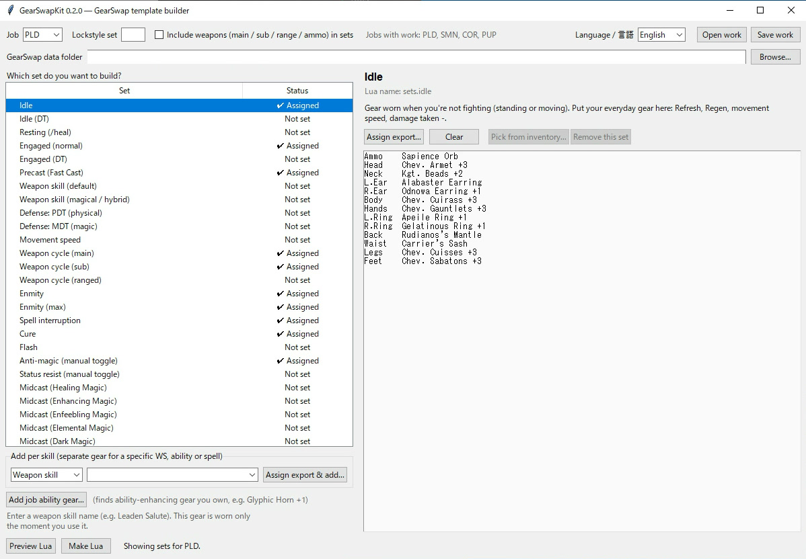
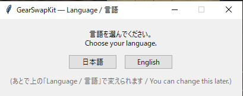
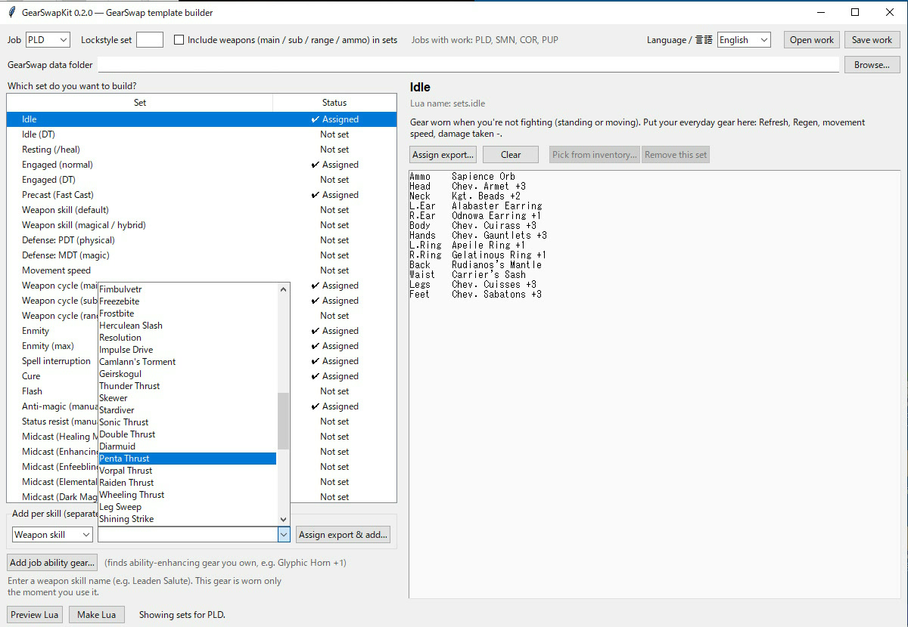
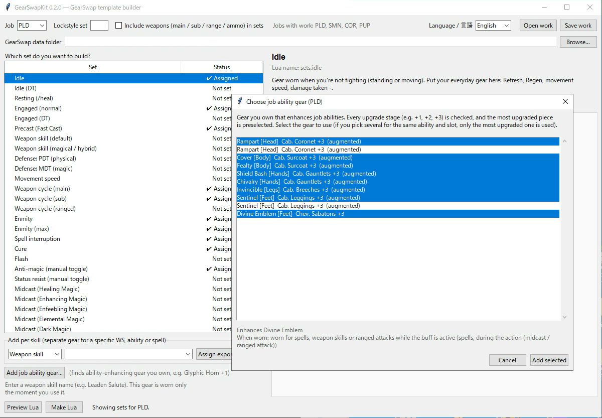
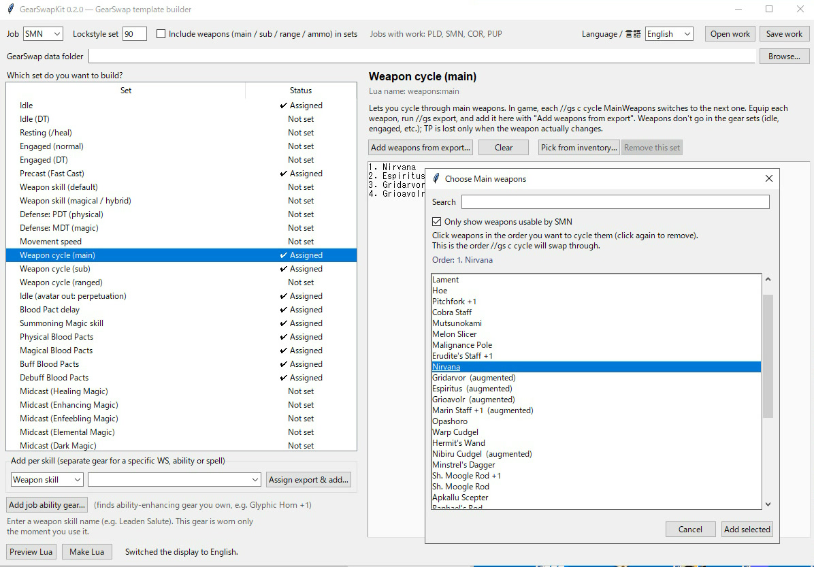

# GearSwapKit

Build a working GearSwap job file for FFXI **without writing a single line of Lua.**

Put your gear on in game, run `//gs export`, tell the kit which situation that gear is for, and it writes the job Lua for you.

After about six months of planning, testing, and plenty of trial and error, GearSwapKit is finally out as a full release: a toolkit that lets anyone put together a GearSwap setup with ease.

> The app runs in English or Japanese (pick one the first time you launch it; switch any time from **Language / 言語** at the top). In English it writes Lua for the **English client**.

---

## Before you start

- **Third-party tools are against the FFXI Terms of Service.** That includes Windower and GearSwap. Using them can get your account actioned, and the author takes no responsibility for that. **Use at your own risk.**
- The kit **never touches the game**: no input, no memory reads or writes. All it reads is the `//gs export` files you create yourself and Windower's `res` folder (to look up names). All it writes is one job Lua and a save file for your work.
- The kit **doesn't optimize gear.** It won't tell you which piece is best. It takes the gear you were wearing and puts it in the set you picked.
- The Lua it makes is a **starting point**. Read it, try it, and tweak it as you learn.

## Download

Grab `GearSwapKit.exe` from [Releases](../../releases) and double-click it. Nothing to install.

You can also run it from source with Python 3 (with tkinter): `python app.py`.

## Quick start

1. **Equip the gear** for one situation in game (say, your idle set).
2. Type `//gs export`. GearSwap writes a file to `Windower4/addons/gearswap/data/export/`. Repeat for each situation (idle, engaged, precast…). You can **rename the exported files**, even to Japanese names (for example `待機セット.lua`): the kit reads the contents, not the file name.
3. Start the kit and pick your **job** and your **GearSwap data folder** (`…/Windower4/addons/gearswap/data`). The kit remembers the folder.
4. Pick a set from the list on the left. The right side explains what it's for.
5. Click **Assign export…** and choose the export file for that set.
6. **Preview Lua** shows what you'll get. **Make Lua** writes `data/<JOB>.lua` (if the file already exists, a backup is saved next to it first).
7. In game, `//gs reload`. Remember to reload every time you remake the Lua.

For gear searches (job ability gear, weapon cycles, ammo), also run `//gs export all` once so the kit can see what you own.

## What it does

- **Pick sets from a list**: idle, engaged, precast (Fast Cast), weapon skills, midcast by magic skill and spell family (Cure, Regen, Refresh, Drain, Helix...), each with a short explanation.
- **Weapon skills sorted for you**: magical, critical-hit (Evisceration, Vorpal Blade, Blade: Jin...), and ranged weapon skills each go to their own set, and per-WS sets are built on top of the right one.
- **Modes**: make the set and the mode shows up. `IdleMode` (DT, Refresh), `OffenseMode` (Acc, SubtleBlow, plus Parry on DNC and Enn on RDM), `HybridMode` (DT), `CastingMode` (MB and Acc on BLM/RDM/SCH/GEO), `RangedMode` (Acc, plus Critical on RNG/COR).
- **Treasure Hunter**: `//gs c toggle TreasureHunter` layers your TH gear over engaged gear until you turn it off.
- **Dual wield by subjob**: `sets.engaged.dual11` goes on automatically when you're /NIN, `dual21` when you're /DNC.
- **Waking up from sleep**: put slip gear in `sets.Sleep` and it goes on the moment you're slept; the HP drain wakes you, and your weapons and gear come back afterward. Gear that works: Frenzy Sallet, Berserker's Torque, Vim Torque (+1), Sacrifice Torque, and stage-one and stage-two prime weapons (the same weapon at stage three or higher doesn't have the drain).
- **Doom**: `sets.midcast.IncreasedCursna` goes on when someone casts Cursna on you, when you use Holy Water, and stays layered over idle and engaged gear while you're Doomed. You still use the Holy Water yourself.
- **More spell families**: Curaga, Cursna, Protect, Shell, bar-status spells, Absorb, Storms; enhancing spells on others (SCH/RDM/WHM); enfeebles split into INT-based and MND-based (RDM/WHM).
- **Add per skill**: give a specific weapon skill, job ability, spell or pet move its own gear by picking it from a dropdown. No typos, no silent failures. Weapon skills are filtered by what your job can use, including mythic and ergon WS.
- **Job ability gear, found for you**: the kit knows every relic and empyrean piece that enhances a job ability, across all 22 jobs and every upgrade stage, and finds the ones you own. It also knows *when* each piece needs to be on: just when you use the ability, the whole time the buff is up, or while you cast under it.
- **Weapon cycle**: `//gs c cycle MainWeapons` (and `SubWeapons` / `RangeWeapons`) swaps through weapons in the order you picked them.
- **Lockstyle**: set a lockstyle number and it's applied after the file loads.
- **Fast Cast math**: adds up the Fast Cast on your precast set and warns you when you're wasting slots past the 80% cap (counting the Red Mage trait and /RDM).
- **Your work is saved**: the kit saves when you close it and reopens your last session next time.

Picking a weapon skill for its own set:

Job ability gear the kit found in a Paladin's inventory:

Choosing weapons for the cycle, in the order you want them:

## Job-specific features

All of these are opt-in (a checkbox or a mode), so they stay out of your way if you don't want them.

**Paladin**
- Enmity, max-enmity, spell interruption and Cure sets. Abilities with no set of their own use your enmity gear.
- **3-stage swap**: Fast Cast at precast, spell interruption while casting, then your Cure or enmity gear right before the spell lands. Timed from your Fast Cast; adjust with `//gs c landadjust 0.4`.
- Magic-defense and status-resist sets you toggle with `//gs c toggle Magical` / `StatusResist`, including the sword and shield; turning them off puts your chosen weapons back.
- Phalanx with Phalanx+ weapons (1.2.1; Phalanx II since 1.2.2): the Phalanx and Phalanx II spell sets and the Phalanx-received set keep the sword and shield from your export. Your weapons from before go back on when the spell lands, or when you finish casting it yourself. If you'd rather not lose TP, drop the weapons from the export or the Lua.

**Puppetmaster**
- Automaton tank and automaton Store TP modes for idle and engaged.
- Automaton WS and enmity (Strobe / Flashbulb) gear, **pre-equipped** before the move fires (at 930 TP, or 2 seconds before Strobe/Flashbulb is ready), since the automaton fires instantly at 1000 TP. Swaps to Xiucoatl for the WS unless you're holding Kenkonken.
- Maneuvers swap to Kenkonken and put your weapon back afterward (or keep it with `//gs c toggle KeepManeuverWeapon` to save TP).

**Summoner**
- Blood Pact delay, Summoning Magic skill, and physical / magical / buff / debuff Blood Pact sets. The kit knows which pact is which.

**Beastmaster**
- Pet moves split into physical (accuracy, TP bonus) and magical/debuff (magic accuracy).

**Corsair / Ranger / Samurai**
- Snapshot (`sets.precast.RA`) and ranged attack sets: Store TP (`sets.RA_STP`) and accuracy (`sets.RA_ACC`, via `RangedMode`). Samurai gets these plus a ranged physical WS set for bows.

**Corsair**
- Phantom Roll (`sets.CorsairRoll`); per-roll gear is built on top of it.
- Quick Draw in three flavors: Store TP (`sets.RA_QDSTP`), damage (`sets.RA_QDDPS`), and magic accuracy (`sets.RA_QDACC`). Make the first two and `//gs c cycle QuickDrawMode` switches between them. Light Shot and Dark Shot always use the accuracy set.

**Corsair / Ranger ammo**
- **Ammo by role**: physical bullets for shooting and physical WS, magic bullets for Leaden Salute and friends, a Quick Draw bullet, and special bullets for chosen WS. Special and Quick Draw bullets are swapped back out afterward so you never shoot them by accident.
- Separate WS sets for melee, ranged, magical and ranged-magical weapon skills.

**Bard**
- Song precast, plus a set for each song family: March, Minuet, Madrigal, Ballad, Minne, Paeon, Etude, Carol, Prelude, Mambo, Lullaby, Threnody, Elegy, Requiem.

**Blue Mage**
- Blue magic split into physical, magical, buff, healing and debuff (magic accuracy) sets. The kit ships with the spell list (`blu_spells.json`), so it works on the English client too.

**Summoner**
- Idle gear while Avatar's Favor is up (`sets.idle.Avatar.Favor`).

**Paladin / Rune Fencer**
- Low-HP gear layered on at 30% HP or less (`sets.LowHp`), and a knockback guard toggled with `//gs c toggle KnockBack`.

**Geomancer**
- Idle with a luopan out (`sets.idle.Luopan`), and Indi gear for when you cast on someone else under Entrust.

**Dancer**
- Waltz, Samba, Jig, Step and Flourish I sets.

**Scholar**
- **Hachirin-no-Obi or Orpheus's Sash**, whichever is better for the weather (storms included), day, and distance to the target.
- Immanence gear always wins while Immanence is up.
- Stormsurge feet when casting storms.

## Keeping your gear sets in a separate file (JOB_gear.lua)

Since 1.2.1, the Lua the kit makes has the gear-swap logic ("SYSTEM") at the top and the gear sets (`init_gear_sets`) at the very bottom, between `-- ======== GEAR SETS BEGIN ========` and `-- ======== GEAR SETS END ========`.

If you want to maintain the gear sets yourself, create `data/<character name>/<JOB>_gear.lua` and paste everything between those two marks into it. It works as is, and GearSwap will use the sets from that file (the same mechanism described below). Leave the system part in `<JOB>.lua`.

From then on, edit your sets in `<JOB>_gear.lua`. While that file exists, gear changes you make in the kit won't apply, even if you regenerate the Lua; the kit is still useful for updating the system part. You'll get a warning about the file when you make the Lua, and it's fine to go ahead.

## If GearSwap ignores your sets

GearSwap loads extra files after your job Lua and they can override it: `user-globals.lua`, `<Name>-globals.lua`, and `<JOB>_gear.lua` / `<Name>_<JOB>_gear.lua`. If any of those define `init_gear_sets`, the kit's sets won't be used. **Make Lua** warns you when it finds one. New GearSwap users usually don't have these.

## Status

- Tested in game on the **Japanese client** (Summoner, Paladin, Puppetmaster, Corsair, Ranger, Scholar, Red Mage, Blue Mage and more).
- **Not yet tested on the English client.** The English output follows the same logic with English names. If something doesn't swap, please open an issue with your job, what you did, and what you saw. Reports are very welcome.
- Beastmaster pet move sorting is tested only in a simulated GearSwap.

## Thanks

- Byrth (GearSwap), Motenten (Mote-Include) and the Windower team.
- Data on job ability gear, Blood Pacts, pet moves, and weather and day bonuses comes from the Japanese FFXI wiki (wiki.ffo.jp).
- Part of the job ability gear timing was cross-checked against greeds' GearSwap data. No code was used.
- The idea of building GearSwap without writing Lua was inspired by Masin-M's GearSwap tools (invdump, GearSwap Generator, GearSwap Optimizer). GearSwapKit is a separate tool written from scratch.

## License

MIT (see `LICENSE`).

## Feedback

Bug reports and "does it work on my job?" reports go in [Issues](../../issues).

Missing a set you'd like? Say, a Thief set for a particular situation — open an issue and describe it, and I'll look at adding it to the kit.
